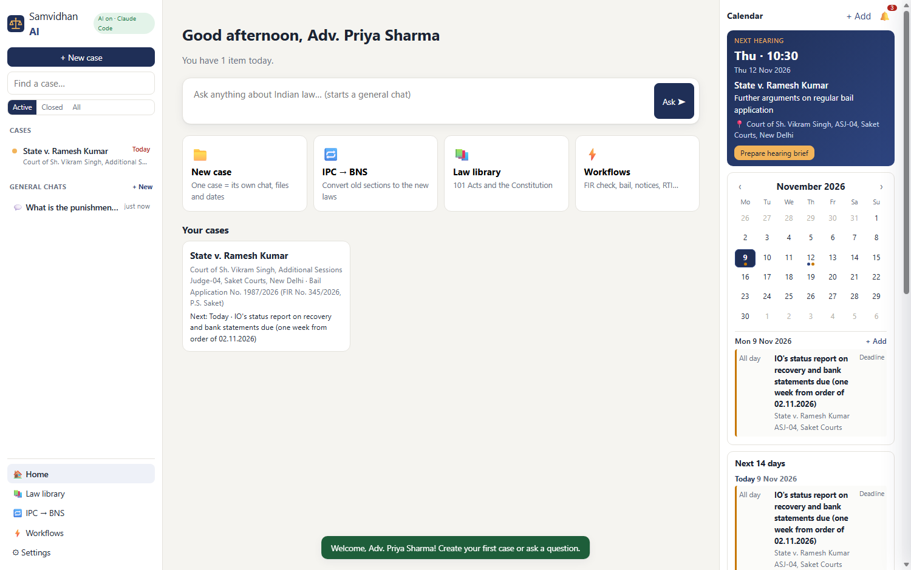
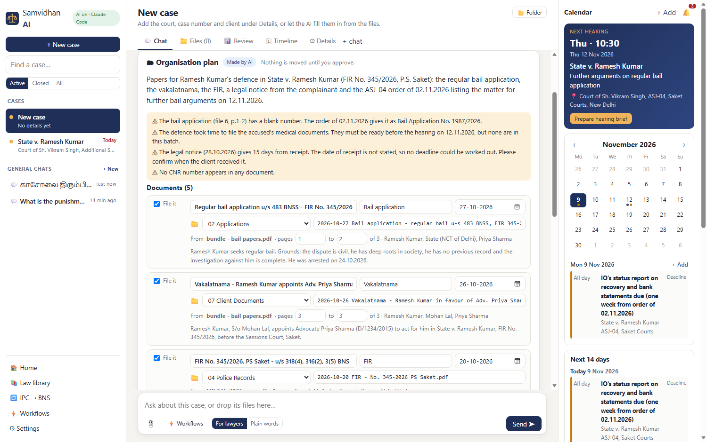
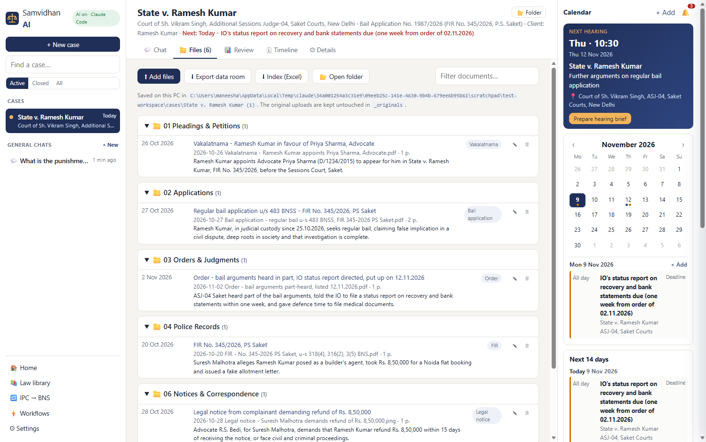
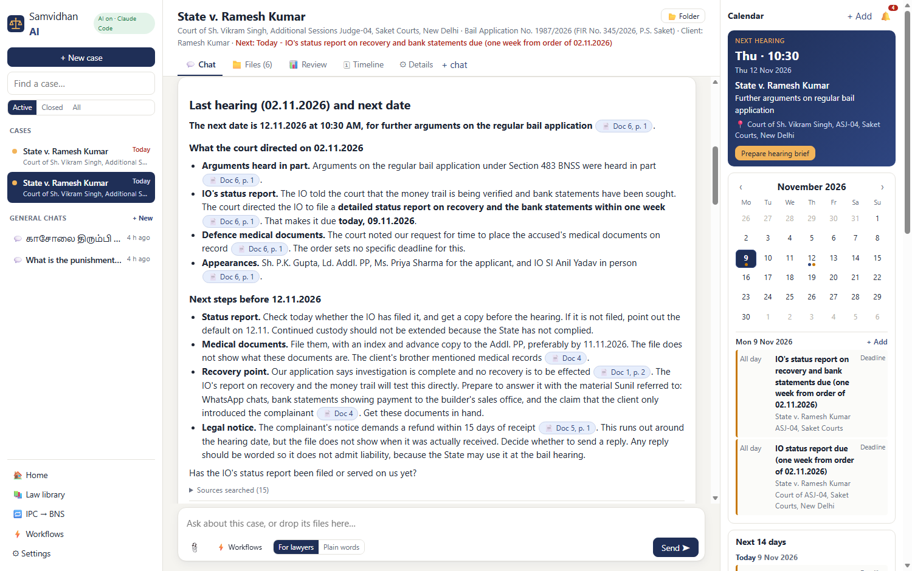
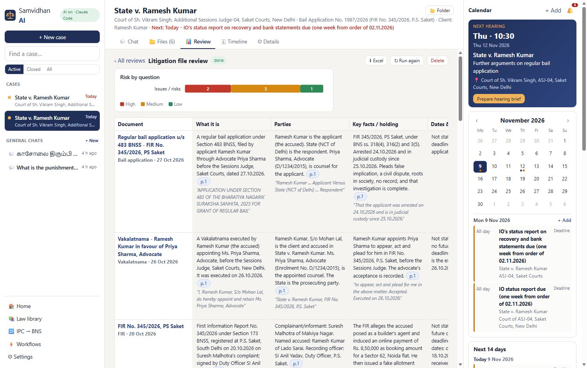
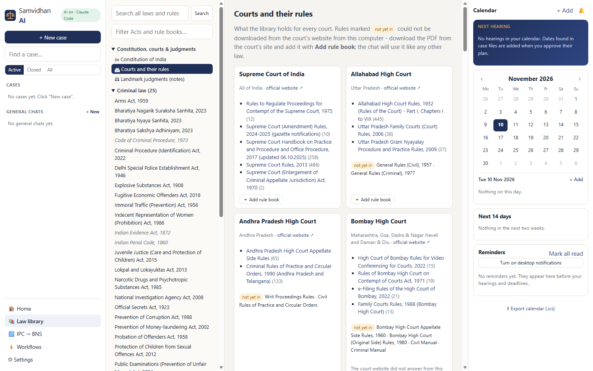
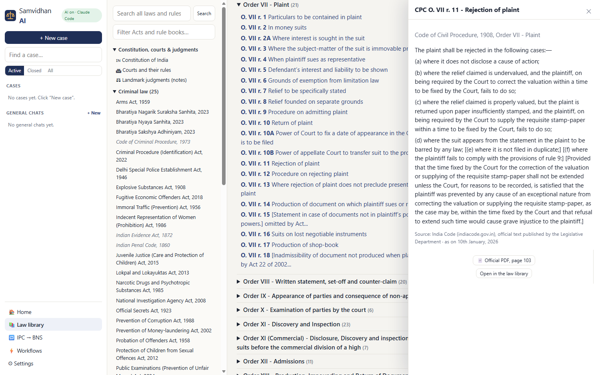

# Samvidhan AI: the AI workspace for Indian lawyers

**One place for a lawyer's practice.**
- **Cases on the left.** Each case has its own chat, files and dates.
- **The AI in the middle.** It knows the BNS, BNSS, BSA, IPC, CrPC, CPC, the Constitution and about 95 more Acts.
- **The calendar and reminders on the right.**

Drop a case's files into its chat. The AI reads them, including scans and photos, and proposes how to split, rename and file them, and which hearing dates and deadlines to add to the calendar. Nothing moves until you approve.



---

## 1. Start the app (no coding needed)

| Step | What to do |
|---|---|
| **One time** | Double-click **`setup.bat`**. It installs everything into this folder. Step 5 builds the law library's search index; that takes about 20 minutes, once. You may close the window and start the app instead, and the app finishes the index in the background. |
| **Every time** | Double-click **`start.bat`**. Your browser opens at <http://127.0.0.1:8000>. Keep the black window open while you work: the reminders run inside it. |
| **To stop** | Close the black `start.bat` window. |

The first time, the app asks your name, your courts and your reminder times.

## 2. How a lawyer uses it

**The fastest way: drop a pile of files on the home screen.** Drag the files of one case, or of many cases mixed together, onto **📂 Drop your case files here** (or click **Choose files**). In about half a minute the app:
1. reads every page (scans and photos too);
2. **sorts the files into cases**, by CNR, case numbers (FIR, bail application, suit…) and party names. A file that belongs to a case you already have goes into that case, so no duplicate case is made;
3. names and files each document, and finds the **hearing dates and deadlines**, each with the sentence it came from.

You see one card: each case with its files, its dates and any warnings. You can:
- rename a new case;
- choose **📁 an existing case** instead;
- **Move to…** a file that landed in the wrong case;
- untick a wrong date, or a whole case.

Then press **✓ Approve all**: the new cases are created, every file goes into its folder, and the dates go into your calendar. Nothing happens before you approve, and **Discard** keeps nothing.

The steps below are the same thing, one case at a time.

**1. New case.** Click **+ New case** on the left. Only a title is needed, and "New case" is fine because the AI fills the details in from the files. Each case gets:
- its own chat,
- its own folder on your PC (`workspace\cases\<case name>\`),
- its own calendar dates.

Cases are never mixed. A question in one case can only see that case's files.

**2. Drop the files into the case chat.** You can drop PDFs, Word files, photos of documents and scans. The app reads every page:
- Normal PDFs are read directly.
- Scans and photos are read by OCR on your PC.
- Pages the OCR can't read, such as Hindi or handwriting, can be read by Claude. You can switch this off in Settings.

**3. The AI proposes an organisation plan.** For every document it gives:

| What | Example |
|---|---|
| Type | Order, FIR, Bail application, Vakalatnama… |
| Its date | 2026-11-02 |
| Folder | `03 Orders & Judgments` |
| New file name | `2026-11-02 Order - bail arguments part-heard, listed 12.11.2026.pdf` |
| One-line summary | What the document says |

It also:
- splits a PDF that holds several documents, for example a bail application on pages 1–2 and a vakalatnama on page 3;
- finds **hearing dates and deadlines**, each with the exact words it found them in;
- fills in **case details** (title, court, case number, client, CNR);
- warns you about problems, for example *"the court gave time to file medical documents; none are in the file"*.



**4. You approve or change the plan.** You can edit any name, folder, type, date or page range. You can also untick a date, or type an instruction such as *"put all orders in one folder called Court Orders"* and the AI revises the plan. Then press **✓ Approve & organise**.

**5. The files are filed.** They are copied into numbered folders with their new names, and your untouched uploads stay in `_originals`. The dates go into the **calendar**. The **Files** tab shows the result, and the case folder opens in Windows Explorer with **📂 Folder**.



**6. Ask anything about the case.** Answers cite the exact page of your document, like `[Doc 6, p. 1]`, and the law, like `[BNSS s. 483]`. Click a citation to open that page or section.



**7. Calendar and reminders (right column).**
- **The top of the column** shows the **next hearing** card, a month calendar with coloured dots, the next 14 days, and anything overdue.
- **Reminders, at the times you choose in Settings:**
  - a morning agenda (*"Good morning, Adv. Sharma: 1 hearing today"*);
  - a reminder the evening before a hearing;
  - a reminder on the morning of a hearing, and one an hour before it;
  - countdowns of 7, 3 and 1 days for deadlines;
  - "overdue" alerts.
- **Where reminders appear:** in the 🔔 list, as pop-ups, and as Windows desktop notifications if you allow them.
- **Prepare hearing brief** writes a one-page brief from the case file.
- **⬇ Export calendar (.ics)** imports everything into Google Calendar or Outlook.

**8. General chats.** **General chats → + New** is for questions that aren't about one case. Files dropped there are read for that chat only, and one click (**Make a case from these files**) turns them into a new case.

## 3. Everything else it does

| Feature | Where | What it does |
|---|---|---|
| **The law library** | 📚 Law library | Central Acts (criminal, civil, family, commercial, tax, labour, IT, environment, courts and procedure), the Constitution (every Article and Schedule) and 45 landmark judgments. From the official India Code PDFs: the **CPC's Orders and Rules** (cite as *CPC O. VII r. 11*), the **Limitation Act's 137 Articles** (*Limitation Act Art. 54*) and the **BNSS First Schedule** (is it bailable, cognizable, which court tries it). The chat searches all of them. Repealed laws (IPC, CrPC, Evidence Act) are kept for older cases and linked to their replacements. |
| **Court rules** | 📚 Law library → 🏛 Courts and their rules | Each rule opens the official PDF at its page. Your case's court and your courts in Settings rank first. The page shows, for all 25 High Courts, what is in and what is not.<br>• **Supreme Court:** the Supreme Court Rules, 2013, the 2024–25 amendments, the Handbook on Practice and Procedure and the contempt rules.<br>• **High Court rules:** Delhi (Original Side 2018), Allahabad, Gujarat, Rajasthan, Orissa, Jharkhand, J&K, Manipur, Meghalaya, Chhattisgarh, AP, and family-court, contempt, PIL, e-filing and video-conferencing rules of many more.<br>• **District-court rules:** Delhi's Rules and Orders (Vol. I–V), the Karnataka Civil and Criminal Rules of Practice, the Tamil Nadu Civil Rules of Practice, the AP/Telangana Criminal Rules of Practice, Rajasthan's General Rules, Orissa's GRCO, Jharkhand's Civil Court Rules, Manipur's Criminal Rules and Orders, and more.<br>• **Gram Nyayalayas** (mobile village courts): the Gram Nyayalayas Act and Gram Nyayalaya rules.<br>• **State Acts:** civil-courts and court-fees Acts. |
| **Add a rule book** | 📚 Law library → ＋ Add a rule book | Your court's rules are missing? Three ways in:<br>1. **Upload** the PDF here.<br>2. **Save it into the inbox folder** `workspace\library\inbox`. It's added automatically within a minute, and the court is recognised from the file name.<br>3. **Paste the text** if there's no PDF at all.<br>The app reads it (scanned PDFs with OCR), finds the chapters and rules, and the chat cites them like any Act, e.g. *[Kerala HC Rules r. 45]*. |
| **IPC → BNS converter** | 🔁 IPC → BNS | Type "IPC 420", "498A", "CrPC 438" or "65B Evidence Act". You get the new section, side by side, with its status: *Retained*, *Change* or *Deleted*. The chat also adds the new section automatically when you ask about an old one. |
| **Tasks** | the buttons in every new chat, or **📋 Tasks** under the chat box, or **📋 Tasks** on Home | Ready-made legal tasks. Click one, fill its small form (2–3 boxes), tick the documents to use and press **Start ▶**: the report or draft is written straight into the chat. Ten are built in: Check an FIR · Rights after arrest · Bail application · Hearing brief · Case chronology · Reply to a legal notice · Cheque-bounce notice (s.138 NI Act) · RTI application · Check a rent agreement · Limitation check. Want to check the AI's approach first? Tick **Show me the steps first**: the AI adapts the steps to your matter, may ask up to 3 questions, and waits for **▶ Approve & run**. Each task is a plain-English recipe file in `skills\`. Whoever sets up the app can edit them or add new ones under **⚙ Settings → Advanced → Task recipes**. |
| **Deep answers** | **🧠 Deep** under the chat box | For a hard question: the strongest model (Claude Opus) thinks longer before it answers. Slower, and about twice the cost with an API key. It stays on until you click it again. |
| **Drafting** | under any answer | **Word** downloads a .docx with your name on top, and **Save to case** puts it in the case's `08 Drafts` folder. Placeholders such as `[CLIENT NAME]` are highlighted. |
| **Review table / due diligence** | case → 📊 Review | Ask the same questions of every document, using a template (litigation, contract, property title) or your own columns. One AI reader per document works in parallel. Each cell gets an answer, a quote, a page and a risk rating. Then you get a **due-diligence report**, a **risk chart**, and an **Excel** export. |
| **Data room** | case → 📁 Files | **Export data room** gives one ZIP of all the folders plus `Index.xlsx`. **Index (Excel)** gives the list alone. |
| **Timeline** | case → 🗓 Timeline | Every dated document and calendar entry in order, with "today" marked. |
| **eCourts / CNR** | case → ⚙ Details | Type the 16-character CNR to see what it means (state, district, year). One click opens the official eCourts page, where you type the CAPTCHA yourself. Save that status page as a PDF and drop it into the case, and its next date is proposed for the calendar. |
| **Languages** | everywhere | Ask in English, हिंदी, Hinglish, मराठी, বাংলা, தமிழ், తెలుగు, ಕನ್ನಡ, മലയാളം, ગુજરાતી, ਪੰਜਾਬੀ, ଓଡ଼ିଆ, اردو or অসমীয়া. You get the answer in the same language, or the one you set in Settings. |







**The library now:** 268 books with 27,316 citable provisions:
- 171 Acts (central, plus State court, civil-court and court-fees Acts).
- 94 court rule books, from the Supreme Court, High Courts, district courts and Gram Nyayalayas.
- 3 handbooks and manuals (Supreme Court Handbook, Telangana HC Manual, Kerala HC Compendium).
- The Constitution and 45 landmark judgment notes, on top.

**How to read a citation chip:**
- 🟢 **Green:** the source was given to the AI.
- 🟠 **Amber:** the section is in the library, but the AI wasn't given it, so click and check it.
- 🔴 **Red:** not found anywhere, so treat it with caution.

Anything the AI says from its own knowledge is marked **(verify)**.

## 4. Where the AI answers come from

**Option A, the default: Claude Code on your PC. No API key is needed.** If the Claude Code extension is installed in VS Code and you're signed in, the app uses it automatically. It's included in your Claude subscription, though the plan's usage limits apply. Claude Code runs with **no tools**, so it can only read what the app sends it and write text.

**Option B: the paid Claude API.** This is the one to use once other lawyers use the app (a Claude subscription is for your own use). Get a key at platform.claude.com (API Keys, with some prepaid credit), then put `ANTHROPIC_API_KEY=sk-ant-…` in `.env` and restart. With `ANSWER_ENGINE=auto` the key is used automatically. Each answer then shows its cost.

**Neither?** The app still works in **search-only mode**. Files are still read and filed using a keyword-based plan, and the calendar, reminders, library and converter all work.

Each kind of job uses the model that fits it, so you pay for the strong model only when it matters:

| Job | Size | With an API key (price per million tokens, in / out) | With Claude Code |
|---|---|---|---|
| Answers, organisation plans, sorting a pile of files, tasks, review tables | main | `CLAUDE_MODEL`, default **Claude Sonnet 5.5** ($2 / $10) | Claude Code's default (`CLAUDE_CODE_MODEL`) |
| **🧠 Deep** answers | deep | `DEEP_MODEL`, default **Claude Opus 5.5** ($4 / $20), thinking longer (`DEEP_EFFORT=high`) | `CLAUDE_CODE_DEEP_MODEL=opus` |
| Translating questions, reading hard scans | fast | **Claude Haiku 5.5** ($0.10 / $0.50) | `CLAUDE_CODE_FAST_MODEL=haiku` |

**Prompt caching (API only).** The parts of a request that repeat are marked for Claude's prompt cache: the rules (the same for every question that day) and, in a case, the case details and file index (the same for every question in that case). If the next question comes within 5 minutes, those parts are read back from the cache for a tenth of the price or less ($0.20 per million instead of $2 on Sonnet). The pages and law picked for each question are different every time, so they are paid in full. The cost under each answer counts all of this. Claude Code does its own caching.

**Which model is good enough? Test it.** `.venv\Scripts\python.exe scripts\eval_models.py` runs the app's own code on files and questions whose right answers are known, once per model (haiku, sonnet, opus), and reports each model's score, time and cost. It tests two jobs: sorting a pile of files, and answering law questions with the right citations. Made-up sample files are included. Your own real files give a better answer; they stay on your PC in `evals\private\`. See [evals/README.md](evals/README.md).

## 5. How it works

```
Your files ─► saved in _originals ─► text of every page (PDF text / OCR / Claude for hard pages)
           ─► AI organisation plan (or a keyword plan) ─► you edit / approve
           ─► split + rename + file ─► pages indexed for search ─► dates into the calendar ─► reminders

Your question ─► (translated to English for the search if needed)
   ├─ this case's own pages     SQLite full-text search + ChromaDB meaning search, filtered to the case
   ├─ Acts and court rules      exact references ("u/s 138 NI Act", "Order 7 Rule 11", "Article 54 of the
   │                            Limitation Act") + legal-term hints + keywords + meaning
   │                            + the old ↔ new equivalent (IPC 302 ↔ BNS 103) + the BNSS bail table row
   │                            + your court's rules ranked first (the case's court, your courts in Settings)
   ├─ the Constitution          as in v1/v2
   └─ landmark judgments
        ─► Claude reads ONLY these sources, cites each one ─► every citation checked (green / amber / red)
```

**The data:**
- **`data/laws/`**
  - The first 101 Acts and 2,629 old ↔ new section mappings were built by `scripts/build_laws.py` from the open dataset [GSMS-B/indian-legal-mcp](https://github.com/GSMS-B/indian-legal-mcp) (MIT/Apache-2.0 licence), compiled from India Code. Those texts contain footnote digits, State amendments and, in places, wrong years.
  - **97 of those Acts now use the official India Code text** (`scripts/officialise_acts.py`): BNS, BNSS, BSA, CPC, NI Act, Contract, Companies, IBC, RBI, SEBI, Customs, CGST, the Labour Codes, the Motor Vehicles, Stamp and Water Acts, and the rest.
    - That means the exact wording as it stands today, with its Illustrations and Schedules, and a page number for every section (one click opens the official PDF there).
      - It includes sections the dataset lacked, e.g. RBI ss. 45-I to 45-IE, Arbitration s. 29A, Dowry Prohibition s. 8A, Companies ss. 393A and 418A, IBC ss. 67B and 67C, and Motor Vehicles s. 217A.
      - It also includes amendments the dataset had missed, e.g. Motor Vehicles s. 192A is now a penalty (Jan Vishwas Act 2026).
    - The amendment footnotes ("Subs. by Act 55 of 2002 …") and the Bill's Statement of Objects and Reasons are left out of the text. Both are in the PDF.
    - An Act is swapped only when the PDF reading matches what the library had:
      - every section found, the titles agree, and the texts are full length;
      - no Illustrations go missing;
      - every section points at a page of the Act itself, not its table of contents;
      - no section's text sits inside another, and no section suddenly swells.
    - The PDF's own list of sections decides what counts as a section, so State amendments are never taken for central sections.
      - A State's own section (e.g. the States' Stamp Act s. 47A) stays in the text of the section it follows, among that section's State amendments, as India Code prints it.
      - The Stamp Act's 260 pages of State Schedules are a provision of their own, "State amendments to Schedule I".
    - Still from the dataset (4): IPC, CrPC, the Evidence Act and the Income-tax Act, 2025. India Code has no PDF of the Act itself for these.
    - A few single sections keep the dataset text, marked "from dataset", where the PDF lacks them (e.g. NI Act s. 81A).
  - Everything else comes straight from the official sources, through `scripts/build_official.py`:
    - **India Code** (indiacode.gov.in, the Legislative Department's site) for the CPC Orders, the Limitation Schedule, the BNSS First Schedule, about 45 more central Acts, and State civil-courts and court-fees Acts.
    - **The courts' own websites** for court rules (sci.gov.in, delhihighcourt.nic.in, gujarathighcourt.nic.in, hcraj.nic.in, orissahighcourt.nic.in …).
  - The PDFs are kept in `data/raw/official/`. Every rule remembers its page, so the app can open the official PDF there.
  - `data/laws/courts.json` lists every court: its website, its main rule books, and which of them are in the library.
- **`data/constitution.json`:** the Constitution, read from the official PDF.
- **`data/cases.json`:** the 45 judgment notes, written for this app.
- **`workspace/`:** **your** cases.
  - `samvidhan.db` is one SQLite file holding the cases, chats, documents, page texts, calendar, reminders, reviews and settings.
  - `cases\` holds your files.
  - It is private and never shared. Back it up like any important folder.

## 6. Project map

```
D:\lawyers-ai\
├─ setup.bat / start.bat      double-click to install / run
├─ .env / .env.example        your settings (AI engine, models)
├─ workspace\                 YOUR cases, files, calendar (created on first start; private)
├─ skills\                    the task recipes (plain English, editable)
├─ evals\                     the model test: sample files + questions with right answers (yours go in evals\private)
├─ data\laws\                 the Acts library     data\constitution.json, data\cases.json
├─ scripts\                   build_constitution.py (official PDF), build_laws.py (Acts),
│                             build_official.py + official_books.py + official.py (India Code, court websites),
│                             eval_models.py (the model test), officialise_acts.py (dataset Acts -> official text)
├─ app\
│  ├─ main.py                 the web server; starts the reminder service
│  ├─ routes\                 the web API: workspace.py, calendar.py, library.py, tools.py
│  ├─ db.py, store.py         the database and everything saved in it
│  ├─ files.py                safe file names, case folders, PDF splitting
│  ├─ extract.py              reading files: PDF text, Word, OCR, Claude for hard pages
│  ├─ organizer.py            the organisation plan: make, revise, approve, file
│  ├─ intake.py               the home-screen drop box: sort a pile of files into cases, then "Approve all"
│  ├─ dates.py                Indian date formats, hearing dates and deadlines in text
│  ├─ casesearch.py           searching one case's own pages
│  ├─ laws.py                 the Acts and rules library, references, IPC → BNS, law search
│  ├─ rulebook.py             reads any Act / rule-book PDF into citable rules (OCR for scans, tables)
│  ├─ rulebooks.py            rule books you add from the Library page
│  ├─ retrieval.py            gathers the sources for a question
│  ├─ assistant.py            the lawyer-assistant rules and the citation check
│  ├─ llm.py                  every AI call (Claude Code or API; fast / main / deep models; prompt caching)
│  ├─ reminders.py            personalised reminders     bus.py  live updates to the page
│  ├─ workflows.py            tasks: Start → result (or steps → approve → run)     review.py  review tables
│  ├─ exports.py              Word, Excel, calendar (.ics), data-room ZIP
│  ├─ search.py, constitution.py, citations.py, cases.py, language.py, answer.py, claude_code.py   (from v1/v2)
│  └─ static\                 the web page: index.html, styles.css, js\*.js
├─ tests\                     200 automatic tests (no internet, AI or API key needed)
└─ docs\                      screenshots
```

## 7. Useful commands

Run these in a terminal in this folder (in VS Code: **Terminal → New Terminal**).

```bat
:: run the tests
.venv\Scripts\python.exe -m pytest

:: try the law search without the web page
.venv\Scripts\python.exe -m app.laws "anticipatory bail"

:: rebuild the Acts library after changing scripts\build_laws.py, then add the official texts again
.venv\Scripts\python.exe scripts\build_laws.py
.venv\Scripts\python.exe scripts\build_official.py --offline

:: download / refresh the official Acts, schedules and court rules (or just one book: ... build_official.py SCR2013)
.venv\Scripts\python.exe scripts\build_official.py
```

The search index updates itself on the next start, and only new or changed rules are added (a few minutes).

## 8. Troubleshooting

| Problem | Fix |
|---|---|
| Badge says "Search-only" | Claude Code wasn't found. Check the Claude extension is installed in VS Code and you're signed in, then restart `start.bat`. |
| "Preparing the law library search… n%" | It's the first start, and the index builds once (about 20 minutes). Exact sections and keywords already work meanwhile. |
| A plan says "Made with keywords" | The AI wasn't available, so the plan is a keyword guess. Check it, or press Discard and upload again once AI is on. |
| Scanned Hindi pages come out as gibberish | Turn on "Let Claude read scanned pages" in Settings. |
| No desktop notifications | Settings → Send a test reminder, and allow notifications when the browser asks. Reminders only run while `start.bat` is open. |
| A file is "open in another program" | Close it in Word or Acrobat before renaming or moving it in the app. |
| `start.bat` says "address already in use" | The app is already running in another window. |

## 9. Limits (version 3.1)

- **Court rules not yet in the library** (Library → 🏛 Courts lists each with a download link):
  - **Bombay:** the court's servers don't answer this network at all. Try your browser on another network, e.g. a phone hotspot.
  - **Madras:** the rules page refuses automated downloads (HTTP 429).
  - **Punjab & Haryana:** the volumes refuse automated downloads (HTTP 403).
  - **Calcutta:** the Original/Appellate Side Rules aren't posted as files.
  - **Kerala:** the full Civil Rules of Practice (1971) and Criminal Rules of Practice (1982) aren't online officially: not on the High Court site (only amendments) and not on the district-court sites. Ways to get them: the High Court library or your Bar association; a printed copy (e.g. Kerala Law Times edition) scanned to PDF; or an RTI application to the High Court of Kerala's Public Information Officer asking for a copy. Then drop the PDF in the inbox.
  - **Tripura and Uttarakhand:** the High Court rules themselves aren't posted.
  - **Gujarat:** the Civil and Criminal Manuals (370 MB and 150 MB scans).

  Download what you can in your browser and save it into the **inbox folder**, or use **＋ Add a rule book** (PDF or pasted text).
- **Why some court sites failed before:** many court websites send an incomplete security-certificate chain. Browsers fill in the missing piece from Windows; Python couldn't. The downloader now checks certificates through Windows too (the `truststore` package), so the Kerala, Karnataka, MP, Patna, Gauhati, Sikkim and Telangana sites work. Certificate checking stays fully on.
- **Scanned books are read with OCR,** for example the Supreme Court Rules, 2013 (a scanned gazette), so a word can occasionally be wrong. Every rule has a **📄 Official PDF** button that opens the exact page, so check important rules there.
- **Still not covered:** State laws in general (rent control, land revenue, police Acts) and the CrPC First Schedule for old IPC cases. For these the AI uses its own knowledge, marked "(verify)".
- **Judgments:** 45 landmark notes only, not full-text judgment search.
- **One user, on this PC.** Reminders appear only while the app runs. Logins, email and WhatsApp reminders need the app online.
- **eCourts has no public API.** The app helps you check the status yourself and never bypasses the CAPTCHA.
- It gives legal information to support your judgment. **Check every citation and fact before you file anything.**

## 10. Roadmap

- **v4, online:**
  - Hosting, logins for lawyers and firms, and email/WhatsApp reminders.
  - Usage limits, and saved answers to cut cost.
  - Live eCourts status through a licensed provider.
- **v5:**
  - Full-text judgment search.
  - The remaining High Courts' rules, and State laws from India Code's State collections.
  - The last 4 of the first 101 Acts from official texts (97 done by v3.8): IPC, CrPC and the Evidence Act from the Gazette, and the Income-tax Act, 2025 once India Code has its PDF.
  - A Word add-in.
